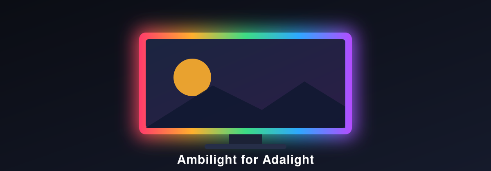

<p align="center">
  
</p>

<h1 align="center">Ambilight for Adalight</h1>

<p align="center">
  <b>Turn a cheap Adalight / WS2812B LED strip into a fast, good-looking TV-style Ambilight.</b><br>
  A native menu-bar / tray app for <b>macOS</b> (Apple Silicon + Intel) and <b>Windows</b> 10/11.<br>
  No Rosetta, no web interface, no cloud. Just plug in, set your LED counts and go.
</p>

<p align="center">
  <a href="../../releases/latest"><b>⬇ Download</b></a> ·
  <a href="#quick-start">Quick start</a> ·
  <a href="#features">Features</a> ·
  <a href="#hardware">Hardware</a> ·
  <a href="#nederlands">Nederlands</a>
</p>

---

## Why this exists

Prismatik/Lightpack is great, but its screen grabbing no longer works on recent Apple-Silicon Macs, and the build that
does work needs Rosetta 2 (going away in macOS 28). HyperHDR and Hyperion work but are web-UI based and, in our testing,
dim and fiddly. This project is a small, single-purpose app that does one thing well:

> grab the edge of your screen → average it per LED → send it to an Adalight Arduino, **as fast as the serial line allows**.

## Features

- **Fast.** ~60 fps end to end with the included firmware (1 Mbaud). Scene changes feel instant, like a Philips TV.
- **Calm.** Anti-flicker dead zone, hue-preserving boost and smart smoothing: static images and text don't shimmer,
  while a cut to black switches the LEDs off immediately.
- **Accurate colours.** Per-channel white balance, gamma, saturation, "colour intensity" and a black-level threshold.
  Orange stays orange.
- **Modes.** Ambilight · static colour · animations (rainbow, colour fade, breathing, chase, fire) · off.
- **Setup tools.** Prismatik-style full-screen zone overlay (click a zone → that LED lights up, shift the start
  position, reverse direction) and a full-white test screen with live R/G/B sliders for white balance.
- **Black-bar detection** for letterboxed movies.
- **Remembers everything.** Settings persist, and you can **export / import** them as one JSON file that works on
  *both* macOS and Windows, so your tuning follows you.
- **Plug-and-play (macOS).** Starts automatically when the Arduino is connected and quits when it's unplugged.
- **Night Shift (macOS).** LEDs warm up together with your screen when Night Shift is active.
- **Tiny.** One menu-bar / tray icon, no background services you didn't ask for.

## Quick start

### 1. Flash the firmware (once)

Any Adalight sketch works (115200 baud), but the included [`FastAdalight`](firmware/FastAdalight/FastAdalight.ino)
is what makes the Ambilight feel instant: it runs at **1 Mbaud** and auto-detects 115200 too.

1. Open `firmware/FastAdalight/FastAdalight.ino` in the Arduino IDE (install the **FastLED** library).
2. Set `NUM_LEDS`, `DATA_PIN` and **`MAX_MA`** for your strip and power supply. ⚠️ See [power](#power--safety).
3. Select *Arduino Uno* / *Nano* (ATmega328P, "Old Bootloader" for many clones) and upload.

> Back up your current firmware first if you want to be able to go back
> (`avrdude … -U flash:r:backup.hex:i`).

### 2. Install the app

Download the latest build from the **[Releases](../../releases/latest)** page.

<details open>
<summary><b>macOS</b> (14+, Apple Silicon and Intel)</summary>

1. Unzip `Ambilight-macOS.zip` and move **Ambilight.app** to *Applications*.
2. The app is ad-hoc signed (not notarised), so the first time: **right-click → Open**, or run
   `xattr -cr /Applications/Ambilight.app`.
3. Grant **Screen Recording** when asked (System Settings → Privacy & Security → Screen & System Audio Recording).
   The status line in the menu tells you whether capture is ON.
4. Menu-bar icon → *Instellingen…* (Settings) → set LED counts per side, check placement with the zone overlay.
5. Menu → **Automatisch starten bij aansluiten** to launch automatically whenever the Arduino is plugged in.

> The macOS UI is currently Dutch. Translating it is a welcome contribution.
</details>

<details open>
<summary><b>Windows</b> (10 / 11, x64 and ARM64)</summary>

1. Unzip `Ambilight-Windows-win-x64.zip` (or `win-arm64`) anywhere and run **Ambilight.exe**.
   (Self-contained: no .NET install needed. SmartScreen may warn because the app is unsigned → *More info → Run anyway*.)
2. Tray icon → *Settings…* → set LED counts per side. The serial port is picked automatically
   (CH340 / Arduino / FTDI first); you can also choose it manually.
3. Tray menu → **Start with Windows** if you want it to start at login.

> The Windows UI follows your system language (English / Dutch).
</details>

### 3. Set up your LEDs

1. **LEDs per side** – count looking at the *front* of the screen. Top, right, bottom, left.
2. **Show screen zones** – every LED gets a zone on screen. Click a zone to light the matching LED. If the wrong LED
   lights up, shift the start position (**Offset**, ←/→ in the overlay) or flip **Reverse direction**.
3. **White test screen** – the screen turns white; adjust R/G/B until the LED light looks the same white.
4. Pick **Ambilight** mode and enjoy.

### Move your settings between macOS and Windows

*Settings → Export…* writes `ambilight-settings.json`; *Import…* on the other machine loads it. Everything that
describes your look and LED layout is shared (see [docs/SETTINGS.md](docs/SETTINGS.md)). The serial port is
intentionally not imported because it differs per computer.

## Hardware

| Part | Notes |
|------|-------|
| Arduino Uno / Nano (CH340 or FTDI) | ATmega328P at 16 MHz. This is what AliExpress "Adalight / USB Ambilight kits" ship with. |
| WS2812B / WS2812 (5 V) LED strip | Data on pin 8 by default (`DATA_PIN` in the sketch). |
| 5 V power supply | **Power the strip from the supply, not from the Arduino/USB.** Common ground between supply and Arduino. |

### Power & safety

A WS2812B LED draws up to ~60 mA at full white. 141 LEDs ≈ 8.5 A in theory. The firmware limits the current to
`MAX_MA` (default **2000 mA**, safe for USB-powered tests). Only raise it to **≈ 90 % of what your 5 V supply can
actually deliver**, and use proper wire gauge for the power rails. You flash firmware and wire hardware at your own
risk.

## How it works

```
 screen ──▶ capture (ScreenCaptureKit / GDI) ──▶ per-LED zone average
        ──▶ dead zone + smoothing ──▶ gamma / white balance / boost
        ──▶ Adalight frame  "Ada" hi lo chk R G B …  ──▶ serial ──▶ Arduino ──▶ WS2812B
```

- **macOS:** ScreenCaptureKit (256 px wide, 60 fps) → Swift/AppKit.
- **Windows:** GDI `StretchBlt` into a 320 px bitmap → C# / WinForms (.NET 8).
- The output thread paces frames to exactly what the serial line can carry, so the USB buffer never fills up and no
  lag builds up.

## Known limitations

- **DRM-protected video** (Netflix/Disney+/… in some players, protected windows) is blacked-out by the operating
  system in screen captures. This app does **not** try to bypass that.
- **Windows:** GDI capture can't see exclusive full-screen games (use borderless/windowed full-screen). Night Shift /
  Night Light following isn't implemented on Windows. The Windows build is new, so please open an issue if
  something is off.
- Single-display capture (choose which display in settings on Windows; main display on macOS).
- Adalight only (no APA102 / DMX / WLED).

## Building from source

```bash
# macOS (needs Xcode command line tools) → build/Ambilight.app (universal)
./build.sh

# Windows (needs .NET 8 SDK, on Windows)
dotnet publish windows/Ambilight/Ambilight.csproj -c Release -r win-x64 --self-contained -p:PublishSingleFile=true
```

CI builds both on every push; tagging `vX.Y.Z` publishes a GitHub Release automatically.

## Troubleshooting

| Symptom | Fix |
|---------|-----|
| Nothing lights up | Check status in the menu: *Arduino: connected?* Wrong baud? Use **1000000** with FastAdalight, **115200** with stock Adalight. |
| Colours wrong (orange → green) | Change **Colour order** (RGB/GRB/…). With FastAdalight leave it on RGB. |
| LEDs dim | Power supply too weak, or `MAX_MA` too low in the firmware. |
| Wrong LED lights up in the overlay | Adjust **Offset** / **Reverse direction**. |
| macOS asks for Screen Recording again after an update | The app is ad-hoc signed; macOS ties the permission to the exact build. Re-enable it once. |
| LEDs stay black while playing a stream | DRM-protected video, see limitations. |
| Flicker | Raise **Anti-flicker**; make sure the strip's ground is shared with the Arduino. |

## Contributing

Issues and pull requests are welcome, especially: UI translations, Windows testing on different hardware, DXGI
capture for Windows, more LED chipsets.

## License

[MIT](LICENSE). Not affiliated with Philips (Ambilight is their trademark), Lightpack, Prismatik or Adalight.

---

<a id="nederlands"></a>

# 🇳🇱 Nederlands

**Ambilight voor Adalight** maakt van een goedkope Adalight/WS2812B-ledstrip een snelle Ambilight zoals op een
Philips-tv. Native app voor **macOS** (Apple Silicon én Intel, geen Rosetta nodig) en **Windows 10/11**.

**Snel starten**

1. Flash `firmware/FastAdalight/FastAdalight.ino` met de Arduino IDE (stel `NUM_LEDS` en vooral `MAX_MA` in voor
   jouw voeding).
2. Download de app bij [Releases](../../releases/latest) en start hem.
   *macOS:* rechtsklik → Openen en geef toestemming voor Schermopname. *Windows:* Ambilight.exe starten
   (SmartScreen: *Meer info → Toch uitvoeren*).
3. Stel het aantal LEDs per zijde in, controleer de plaatsing met **Schermvlakken tonen** en stel de witbalans in
   met het **Wit testscherm**.
4. Kies **Ambilight** en klaar.

**Instellingen delen:** *Exporteren…* op de ene computer, *Importeren…* op de andere. Hetzelfde bestand werkt op
macOS én Windows.

**Let op:** DRM-video (bijv. sommige streamingdiensten) is zwart in schermopnames; dat omzeilt deze app niet.
De macOS-app is nu in het Nederlands; de Windows-app volgt je systeemtaal (Nederlands/Engels).
